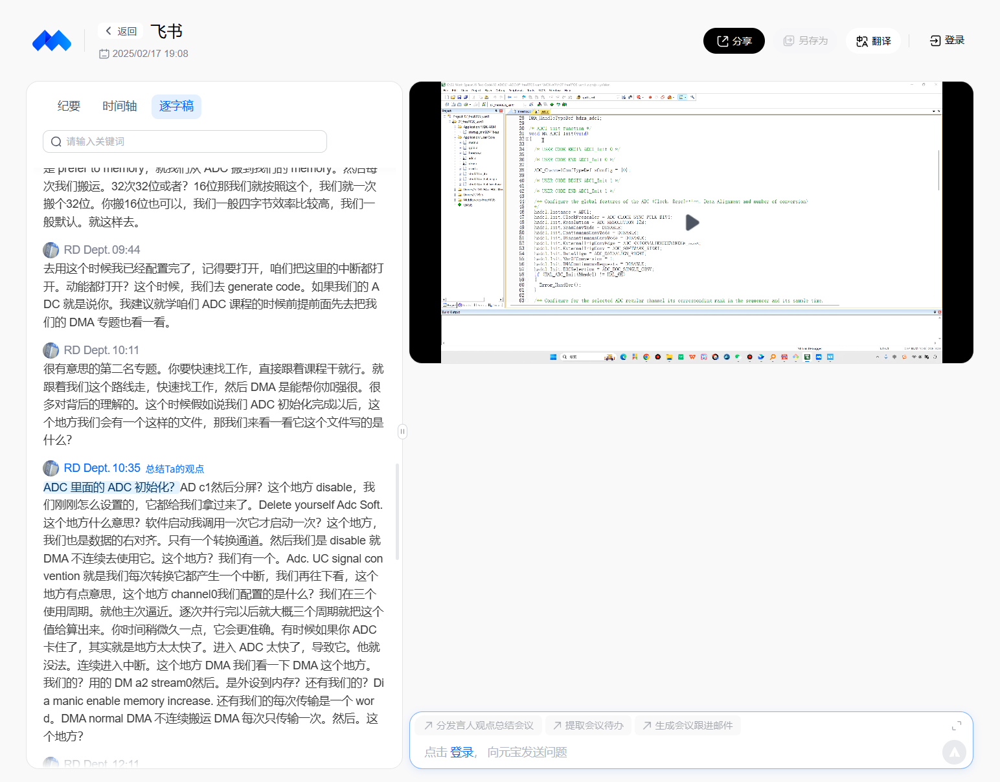
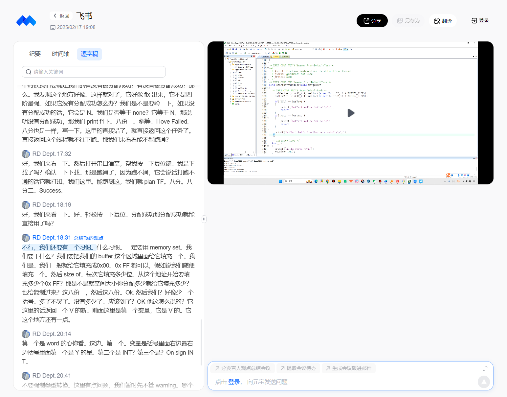

# 01 搭建环境与申请 buffer

来源：https://meeting.tencent.com/cw/2Z07gJwZed ，2025-02-17，时长21:19；对应初始工程→V1。

本次阅读：读取平台自动逐字稿00:01～21:14全部27段，核对实际视频的CubeMX启动、ADC初始化代码、malloc与NULL判断画面。截图已经保存在`截图/`，不是重新绘制的示意图。未逐帧观看全片。

| 时间 | 讲述与操作 |
|---|---|
| 00:01～02:16 | 使用串口模板；检查CubeMX 6.8.1、MDK 5.36/5.38；配置SW调试、Reset and Run；串口PA9/PA10验证hello world |
| 02:16～03:44 | ADC1选择IN0，对应PA0；解释STM32采用逐次逼近型ADC |
| 03:44～05:04 | 12位、PCLK2/4、右对齐；有效数据12位，右对齐时高位补零 |
| 05:04～06:53 | 扫描模式按通道序列转换；连续模式重复序列；间断模式按触发分组完成序列 |
| 06:53～08:29 | DMA连续请求、EOC选择、常规与注入转换；本实验使用常规单通道 |
| 08:29～10:11 | DMA2 Stream0、外设到内存、Word、内存递增、Normal；使能所需中断并生成代码 |
| 10:11～12:24 | 在adc.c对照CubeMX设置；初始化字段、通道、采样时间、DMA模式等 |
| 12:37～15:18 | 定义uint32_t指针buffer1/2；BUFFER_SIZE=1；malloc(sizeof(uint32_t)*BUFFER_SIZE) |
| 15:18～17:32 | 包含stdlib.h；检查两个分配结果是否NULL；成功打印，失败不继续访问 |
| 17:32～18:31 | 下载运行检查分配成功输出；提醒分配后初始化内存 |
| 18:31～20:41 | 使用memset设置0x00/0xFF；长度应等于分配字节数；检查参数和编译警告 |
| 20:41～21:14 | 本段止于两块内存分配成功，后面才写启动DMA、队列和交替buffer |

## 已保存的实际画面

## 阅读时的技术核对

- ADC_SAMPLETIME_3CYCLES指采样阶段，不是完整12位转换仅用3个周期；总转换时间还含转换阶段。
- EOCSelection控制EOC标志产生时机，不会单独使能CPU中断。DMA完成后的ADC回调由HAL的DMA回调链调用。
- DMA Normal完成配置的Length个数据项后停止，不是无论Length多少都只传1项。本实验Length=1时恰好只有1项。
- 16位半字传输同样可用；实际分配类型、宽度、长度须匹配，不能据HAL函数形参uint32_t*认定硬件只支持32位buffer。
- malloc返回NULL要处理；FreeRTOS任务入口不应直接return，通常使用错误处理并vTaskDelete(NULL)。视频示例的return不能直接当成正式任务退出写法。
- memset需要string.h；按字节填充，memset(p,0xFF,4)得到0xFFFFFFFF，memset(p,1,4)得到0x01010101。
- 视频说“先不管warning”只描述当时演示，后续自行写代码应检查并消除原因。
