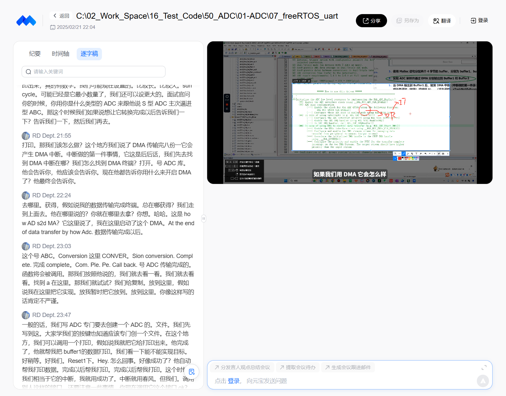

# 02 启动 DMA 传输并进入中断

来源：https://meeting.tencent.com/cw/NQjMPxgJ04 ，2025-02-21 22:04；对应 V1→V2。

本次阅读：读取平台逐字稿00:01～27:00全部段落，核对实际视频中的总线架构图、HAL API文档、代码修改和串口输出画面。截图已保存于`截图/`。未逐帧观看全片。

| 时间 | 讲述与操作 |
|---|---|
| 00:01～04:30 | 回顾上节；讲DMA对总线带宽的意义：ADC在APB2，经DMA2到SRAM，减少CPU搬运占用 |
| 04:30～05:40 | 回到作业：让ADC采样结果由DMA分别写入buffer1、buffer2；先做单次验证 |
| 05:40～07:59 | 打开stm32f4xx_hal_adc.c/H读“How to use this driver”；区分中断方式与DMA方式；ADC结果在DR，DMA方式产生DMA请求 |
| 07:59～09:22 | 定位HAL_ADC_Start_DMA()；解释三个参数：ADC句柄、目的buffer、要搬运的数据项数 |
| 09:22～12:07 | 在freertos.c加测试日志和HAL_ADC_Start_DMA(&hadc1, buffer1, BUFFER_SIZE)；extern声明hadc1 |
| 12:07～13:21 | 传参细节：句柄用&取地址；buffer直接传指针；长度用BUFFER_SIZE |
| 13:21～16:15 | 直接打印buffer1验证；刚启动就读取，读到0xFF（有符号打印为-1），说明ADC尚未转换完成 |
| 16:15～18:24 | 强调检查API返回值；加if(HAL_OK!=...)打印失败；单次采样验证完成 |
| 18:24～21:16 | 引出“DMA搬完要通知”：说明ADC转换需要时间，取决SAR结构与采样时间 |
| 21:16～25:43 | 在HAL文档中找传输完成回调HAL_ADC_ConvCpltCallback()，实现中打印buffer1；复位后自动打印，验证中断回调生效 |
| 25:43～27:00 | 再找HAL_ADC_ErrorCallback()，加错误提示；本节止于“DMA中断里发队列/任务通知给线程A”的引入 |

## 已保存的实际画面

## 阅读时的技术核对

- `HAL_ADC_Start_DMA(hadc, pData, Length)`：Length是DMA要搬运的“数据项个数”，单位由DMA配置的数据宽度决定，不是字节数。
- 刚启动就读buffer会读到旧值，必须等转换完成；用回调或信号量同步，不能靠“看起来很快”。
- 使用DMA时`HAL_ADC_ConvCpltCallback()`由DMA传输完成路径触发，不是ADC单次EOC直接触发；回调里不应长时间阻塞。
- 回调中的打印属于调试手段，正式代码要注意执行时间与线程安全。
- 传入`buffer1`（`uint32_t *`）与`&hadc1`的类型要匹配HAL原型；不要用`&buffer1`。
- 检查返回值是必要的；但只在启动时检查一次不能替代运行期错误回调。
